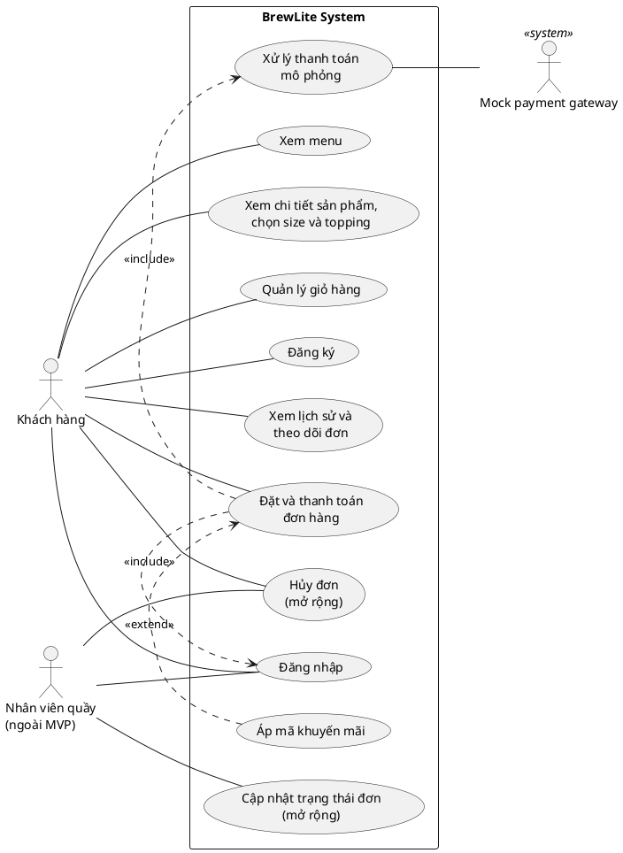

# BrewLite – Software Requirements Specification (SRS)

## 1. Mục đích và phạm vi

Tài liệu này đặc tả yêu cầu chức năng (FR), yêu cầu phi chức năng (NFR), mức ưu tiên theo MoSCoW và tiêu chí chấp nhận (Acceptance Criteria) của hệ thống BrewLite.

Luồng nghiệp vụ chính:

**Xem menu → Chọn tùy chọn → Giỏ hàng → Đăng nhập → Đặt đơn → Thanh toán → Theo dõi đơn.**

Công nghệ bắt buộc: Next.js (frontend, mobile-first), NestJS (backend), PostgreSQL (CSDL). Thanh toán dùng dịch vụ mô phỏng trong phạm vi Bài tập lớn.

Phạm vi MVP gồm các FR mức Must. Các chức năng của Nhân viên quầy (FR-12, FR-13) là phần mở rộng (Should).

## 2. Quy ước mức ưu tiên MoSCoW

- Must: Bắt buộc để đáp ứng chức năng cốt lõi.
- Should: Quan trọng, nên hoàn thành nếu nguồn lực cho phép.
- Could: Bổ sung, thực hiện khi còn thời gian.
- Won't: Không thực hiện trong phiên bản hiện tại.

## 3. Tác nhân (Actors)

| Actor                | Loại                          | Mô tả                                                        |
| -------------------- | ----------------------------- | ------------------------------------------------------------ |
| Khách hàng           | Người dùng                    | Xem menu, đặt và thanh toán đơn, theo dõi đơn                |
| Nhân viên quầy       | Người dùng (ngoài MVP)        | Đăng nhập, hủy đơn, cập nhật trạng thái pha chế              |
| Mock payment gateway | Hệ thống ngoài (`<<system>>`) | Dịch vụ thanh toán mô phỏng, trả kết quả thành công/thất bại |

## 4. Trạng thái đơn hàng

| Trạng thái       | Ý nghĩa                             |
| ---------------- | ----------------------------------- |
| `PENDING`        | Đơn vừa tạo, chờ thanh toán         |
| `PAID`           | Thanh toán thành công               |
| `PAYMENT_FAILED` | Thanh toán lỗi (có thể thử lại)     |
| `PREPARING`      | Barista đã nhận và đang pha chế     |
| `READY`          | Pha xong, chờ giao khách            |
| `COMPLETED`      | Đã giao khách (trạng thái kết thúc) |
| `CANCELLED`      | Đơn bị hủy (trạng thái kết thúc)    |

Chuyển tiếp hợp lệ:

- `PENDING → PAID`, `PENDING → PAYMENT_FAILED`, `PENDING → CANCELLED`
- `PAYMENT_FAILED → PENDING` (thử lại), `PAYMENT_FAILED → CANCELLED`
- `PAID → PREPARING`, `PAID → CANCELLED`
- `PREPARING → READY`
- `READY → COMPLETED`

Mọi chuyển tiếp khác bị từ chối.

## 5. Yêu cầu chức năng (Functional Requirements)

### FR-01 – Xem menu

- Use case: Xem menu
- Mô tả: Khách hàng xem danh sách đồ uống đang bán.
- Ưu tiên: Must
- Tiêu chí chấp nhận:
  1. Khi API trả dữ liệu thành công, giao diện hiển thị danh sách sản phẩm.
  2. Mỗi sản phẩm hiển thị ít nhất hình, tên và giá bán.
  3. Danh sách rỗng thì hiển thị trạng thái empty.
  4. Không tải được dữ liệu thì hiển thị trạng thái error thay vì trang trống.

### FR-02 – Xem chi tiết sản phẩm, chọn size và topping

- Use case: Xem chi tiết sản phẩm, chọn size và topping
- Mô tả: Khách hàng xem chi tiết và chọn size/topping của sản phẩm.
- Ưu tiên: Must
- Tiêu chí chấp nhận:
  1. Mở được trang chi tiết của sản phẩm tồn tại.
  2. Trang hiển thị tên và giá bán.
  3. Hiển thị các size (S/M/L) và topping khả dụng để chọn.
  4. Giá hiển thị được tính lại theo tùy chọn đã chọn.
  5. Mã sản phẩm không tồn tại thì hiển thị thông báo phù hợp (HTTP `404` ở API).

### FR-03 – Quản lý giỏ hàng

- Use case: Quản lý giỏ hàng
- Mô tả: Khách hàng thêm, sửa số lượng và xóa sản phẩm trong giỏ.
- Ưu tiên: Must
- Tiêu chí chấp nhận:
  1. Sản phẩm với tùy chọn hợp lệ thêm được vào giỏ.
  2. Thay đổi số lượng hoặc xóa được sản phẩm khỏi giỏ.
  3. Tổng tiền tính lại đúng theo số lượng, tùy chọn và quy tắc giá.
  4. Số lượng không hợp lệ (≤ 0, không phải số nguyên) bị từ chối.
  5. Giỏ hàng rỗng thì không thể tiếp tục đặt đơn.
  6. Biểu tượng giỏ hàng hiển thị số lượng sản phẩm hiện có.

### FR-04 – Đăng ký

- Use case: Đăng ký
- Mô tả: Khách hàng tạo tài khoản mới.
- Ưu tiên: Must
- Tiêu chí chấp nhận:
  1. Dữ liệu hợp lệ (email, mật khẩu) được tiếp nhận và tạo tài khoản.
  2. Email đã tồn tại hoặc dữ liệu sai định dạng bị từ chối (`409`/`400`).
  3. Mật khẩu được lưu dạng băm (bcrypt), không lưu bản rõ.

### FR-05 – Đăng nhập

- Use case: Đăng nhập (dùng chung Khách hàng và Nhân viên)
- Mô tả: Người dùng đăng nhập và nhận JWT.
- Ưu tiên: Must
- Tiêu chí chấp nhận:
  1. Thông tin hợp lệ trả về JWT có thời hạn.
  2. Thông tin sai bị từ chối (`401`), không tạo phiên hợp lệ.
  3. API được bảo vệ từ chối request thiếu hoặc sai token (`401`).
  4. Token chứa vai trò (`CUSTOMER` hoặc `STAFF`) để phân quyền.

### FR-06 – Đặt đơn hàng

- Use case: Đặt và thanh toán đơn hàng (`<<include>>` Đăng nhập)
- Mô tả: Khách hàng tạo đơn từ giỏ hàng hợp lệ.
- Ưu tiên: Must
- Tiêu chí chấp nhận:
  1. Phải đăng nhập trước khi đặt đơn (chưa đăng nhập thì `401` và chuyển hướng đến trang đăng nhập).
  2. Hệ thống kiểm tra dữ liệu giỏ hàng (validate) và tình trạng còn hàng trước khi tạo đơn.
  3. Sản phẩm hết hàng không được chấp nhận vào đơn.
  4. Đơn tạo thành công lưu đủ sản phẩm, size, số lượng, tổng tiền, ở trạng thái `PENDING`, và trả về mã đơn.
  5. Giá do server tính lại, không tin giá gửi từ client.
  6. Dữ liệu không hợp lệ thì trả lỗi rõ ràng và không tạo đơn.

### FR-07 – Áp mã khuyến mãi

- Use case: Áp mã khuyến mãi (`<<extend>>` Đặt đơn)
- Mô tả: Khách hàng nhập mã giảm giá khi đặt đơn.
- Ưu tiên: Must (thuộc Task 10)
- Tiêu chí chấp nhận:
  1. Mã hợp lệ (còn hạn, đúng điều kiện) làm giảm tổng tiền đúng theo quy tắc của mã.
  2. Mã sai, hết hạn hoặc không đủ điều kiện bị từ chối kèm thông báo rõ ràng.
  3. Đơn lưu lại mã đã áp và số tiền giảm.
  4. Mỗi đơn chỉ áp tối đa 1 mã.

### FR-08 – Thanh toán mô phỏng

- Use case: Xử lý thanh toán mô phỏng (liên kết Mock payment gateway; được `<<include>>` bởi Đặt và thanh toán đơn hàng)
- Mô tả: Xử lý thanh toán đơn qua dịch vụ mô phỏng.
- Ưu tiên: Must
- Tiêu chí chấp nhận:
  1. Khách hàng gửi được yêu cầu thanh toán (`POST /payments`) cho đơn `PENDING` hoặc `PAYMENT_FAILED` thuộc tài khoản mình, chọn phương thức Ví hoặc Thẻ.
  2. Hệ thống gọi dịch vụ mô phỏng và nhận kết quả.
  3. Xử lý được cả kết quả thành công và thất bại.
  4. Yêu cầu không hợp lệ (đơn không tồn tại, không thuộc người dùng, đơn đã `PAID`/`CANCELLED`) bị từ chối.

### FR-09 – Thanh toán idempotent

- Use case: Xử lý thanh toán mô phỏng
- Mô tả: Gửi lặp lại cùng một yêu cầu thanh toán không gây tính tiền hoặc tạo đơn 2 lần.
- Ưu tiên: Must (thuộc Task 10)
- Tiêu chí chấp nhận:
  1. `POST /payments` yêu cầu header `Idempotency-Key`; thiếu key thì trả `400`.
  2. Gửi 2 lần cùng key chỉ tạo 1 bản ghi thanh toán, lần sau trả lại kết quả của lần đầu.
  3. Ràng buộc unique trên `idempotencyKey` ở CSDL.
  4. Có test tự động chứng minh tiêu chí 2.

### FR-10 – Ghi nhận và thông báo kết quả thanh toán

- Use case: Đặt và thanh toán đơn hàng
- Mô tả: Hệ thống lưu và báo kết quả thanh toán cho khách.
- Ưu tiên: Must
- Tiêu chí chấp nhận:
  1. Thành công: đơn chuyển `PAID`, hiển thị mã đơn và màn hình xác nhận.
  2. Thất bại: đơn chuyển `PAYMENT_FAILED`, hiển thị thông báo lỗi, giỏ hàng được giữ nguyên.
  3. Không bao giờ hiển thị thành công khi dịch vụ trả kết quả thất bại.
  4. Sau khi đơn `PAID`, cộng điểm tích lũy (`loyaltyPoints`) cho khách theo quy tắc đã thống nhất; thất bại thì không cộng.

### FR-11 – Xem lịch sử và theo dõi đơn hàng

- Use case: Xem lịch sử và theo dõi đơn
- Mô tả: Khách hàng xem danh sách đơn và trạng thái hiện tại của từng đơn.
- Ưu tiên: Must
- Tiêu chí chấp nhận:
  1. `GET /orders/me` chỉ trả đơn thuộc tài khoản đang đăng nhập.
  2. Mỗi đơn hiển thị mã đơn, thời điểm đặt, tổng tiền và trạng thái.
  3. Xem được chi tiết và trạng thái của một đơn thuộc tài khoản mình; trạng thái khớp dữ liệu hiện tại.
  4. Truy cập đơn của tài khoản khác bị từ chối (`403` hoặc `404`).
  5. Chưa có đơn thì hiển thị trạng thái empty.

### FR-12 – Hủy đơn

- Use case: Hủy đơn (mở rộng) – Khách hàng và Nhân viên
- Mô tả: Hủy đơn khi còn ở trạng thái cho phép.
- Ưu tiên: Should
- Tiêu chí chấp nhận:
  1. Khách hàng hủy được đơn của mình khi đơn ở `PENDING` hoặc `PAYMENT_FAILED`.
  2. Nhân viên hủy được đơn ở `PAID` (theo quy tắc chuyển trạng thái).
  3. Đơn đã `PREPARING`, `READY`, `COMPLETED` hoặc `CANCELLED` không hủy được (`409`).
  4. Hủy thành công thì đơn chuyển `CANCELLED` và hoàn lại tồn kho đã giữ.
  5. Người không có quyền bị từ chối.

### FR-13 – Cập nhật trạng thái đơn

- Use case: Cập nhật trạng thái đơn (mở rộng) – Nhân viên
- Mô tả: Nhân viên cập nhật trạng thái pha chế của đơn.
- Ưu tiên: Should
- Tiêu chí chấp nhận:
  1. Chỉ vai trò `STAFF` gửi được yêu cầu cập nhật; vai trò khác nhận `403`.
  2. Chỉ chấp nhận chuyển tiếp hợp lệ theo Mục 4 (`PAID → PREPARING → READY → COMPLETED`).
  3. Trạng thái hợp lệ được lưu và truy vấn lại thấy ngay.
  4. Trạng thái không hợp lệ bị từ chối (`409`).
- Ghi chú: Nếu chưa làm giao diện cho nhân viên, có thể kiểm tra qua API.

### FR-14 – Máy trạng thái đơn hàng (Order State Machine)

- Use case: hỗ trợ Đặt đơn, Hủy đơn, Cập nhật trạng thái
- Ưu tiên: Must (thuộc Task 10)
- Tiêu chí chấp nhận:
  1. Mọi thay đổi trạng thái đều đi qua một hàm kiểm tra tập trung (ví dụ `assertTransition`).
  2. Chuyển tiếp không nằm trong Mục 4 bị chặn và báo lỗi.
  3. `COMPLETED` và `CANCELLED` là trạng thái kết thúc, không chuyển tiếp tiếp được.
  4. Có unit test chứng minh chặn được chuyển trạng thái sai.

### FR-15 – Kiểm soát tồn kho khi đặt đồng thời

- Use case: Đặt và thanh toán đơn hàng
- Ưu tiên: Must (thuộc Task 10)
- Tiêu chí chấp nhận:
  1. Kiểm tra và trừ tồn kho trong cùng một transaction.
  2. Dùng optimistic locking (cột `version`) hoặc cơ chế tương đương để tránh bán vượt số lượng.
  3. Khi nhiều yêu cầu cùng đặt sản phẩm còn ít hàng, tổng số lượng bán ra không vượt tồn kho; yêu cầu thua trả lỗi rõ ràng.
  4. Có integration test mô phỏng đặt đồng thời chứng minh tiêu chí 3.

### FR-16 – Cổng thanh toán thực tế của bên thứ ba

- Ưu tiên: Won't
- Tiêu chí chấp nhận:
  1. Phiên bản Bài tập lớn không xử lý giao dịch tài chính thực.
  2. Thanh toán chỉ dùng dịch vụ mô phỏng.

## 6. Yêu cầu phi chức năng (Non-functional Requirements)

### NFR-01 – Hiệu năng

- Ưu tiên: Must
- Tiêu chí chấp nhận:
  1. Bài kiểm thử ghi rõ môi trường, bộ dữ liệu seed và cách đo.
  2. Với dữ liệu seed, `GET /products` phản hồi dưới 500 ms (95% trên N request).
  3. Request lỗi hoặc quá thời gian trả đúng mã HTTP và thông báo rõ ràng.

### NFR-02 – Bảo mật

- Ưu tiên: Must (riêng tiêu chí 6: Should)
- Tiêu chí chấp nhận:
  1. Request chưa xác thực đến API được bảo vệ bị từ chối (`401`).
  2. Khách hàng không truy cập được đơn của tài khoản khác.
  3. Chỉ `STAFF` đổi được trạng thái đơn; vai trò khác nhận `403`.
  4. Mật khẩu lưu dạng băm; JWT có thời hạn; dữ liệu sai định dạng bị từ chối (`400`).
  5. Secret không nằm trong repository; log không ghi thông tin nhạy cảm.
  6. (Should) Khi triển khai thật, frontend và API truy cập qua HTTPS; database không có địa chỉ public.

### NFR-03 – Tính khả dụng

- Ưu tiên: Should
- Tiêu chí chấp nhận:
  1. API và database bình thường thì `GET /health` trả `200`.
  2. Database lỗi thì `GET /health` trả `503`.

### NFR-04 – Khả năng triển khai

- Ưu tiên: Must (riêng tiêu chí 4: Should)
- Tiêu chí chấp nhận:
  1. `README.md` hướng dẫn chạy local, test và build.
  2. `.env.example` liệt kê đủ biến môi trường, không chứa secret thật.
  3. `docker compose up` chạy được frontend, backend và database.
  4. (Should) Pipeline CI chạy lint, test, build tự động.
  5. Người ngoài nhóm làm theo README là chạy được các chức năng cơ bản.

### NFR-05 – Tương thích và tính dùng

- Ưu tiên: Must
- Tiêu chí chấp nhận:
  1. Luồng chính chạy đúng trên Chrome, Edge, Firefox và Safari bản mới.
  2. Giao diện hiển thị đúng ở chiều rộng 360 px (mobile-first).
  3. Mọi màn hình có trạng thái loading, empty và error cơ bản.

### NFR-06 – Khả năng kiểm thử

- Ưu tiên: Must
- Tiêu chí chấp nhận:
  1. Có unit/integration test cho: chặn chuyển trạng thái sai, idempotency, đặt đồng thời không vượt tồn kho.
  2. Lệnh chạy test được ghi trong README.

## 7. Sơ đồ Use Case tổng quát

