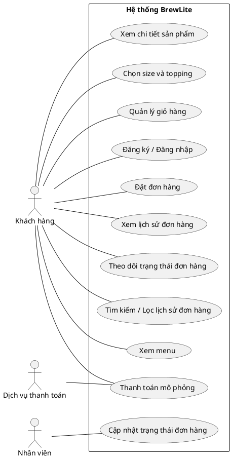

# BrewLite – Software Requirements Specification (SRS)

## 1. Mục đích và phạm vi

Tài liệu này đặc tả yêu cầu chức năng (Functional Requirements – FR), yêu cầu phi chức năng (Non-functional Requirements – NFR), mức ưu tiên theo MoSCoW và tiêu chí chấp nhận (Acceptance Criteria) của hệ thống BrewLite.

Luồng nghiệp vụ chính của BrewLite:

**Xem menu → Chọn tùy chọn → Giỏ hàng → Đặt đơn → Thanh toán → Theo dõi đơn.**

Công nghệ bắt buộc: Next.js cho frontend theo hướng mobile-first/PWA, NestJS cho backend và PostgreSQL để lưu dữ liệu. Thanh toán sử dụng dịch vụ mô phỏng trong phạm vi bài tập.

## 2. Quy ước mức ưu tiên MoSCoW

- Must: Bắt buộc để đáp ứng chức năng cốt lõi.
- Should: Quan trọng, nên hoàn thành nếu nguồn lực cho phép.
- Could: Chức năng bổ sung, thực hiện khi còn thời gian.
- Won't: Không thực hiện trong phạm vi phiên bản hiện tại.

## 3. Yêu cầu chức năng (Functional Requirements)

### FR-01 – Xem menu

- Mô tả: Hệ thống cho phép khách hàng xem danh sách đồ uống đang có trên menu.
- Ưu tiên: Must
- Tiêu chí chấp nhận:
  1. Khi API trả dữ liệu thành công, giao diện hiển thị danh sách sản phẩm.
  2. Mỗi sản phẩm hiển thị ít nhất tên và giá bán.
  3. Nếu danh sách rỗng, hệ thống hiển thị trạng thái empty phù hợp.
  4. Nếu không tải được dữ liệu, hệ thống hiển thị trạng thái error thay vì để trang trống.

### FR-02 – Xem chi tiết sản phẩm và tùy chọn

- Mô tả: Hệ thống cho phép khách hàng xem chi tiết sản phẩm và các tùy chọn size/topping được hỗ trợ.
- Ưu tiên: Must
- Tiêu chí chấp nhận:
  1. Khách hàng có thể mở trang chi tiết của sản phẩm tồn tại.
  2. Trang chi tiết hiển thị tên và giá bán của sản phẩm.
  3. Các size/topping khả dụng được hiển thị để khách hàng lựa chọn.
  4. Khi mã sản phẩm không tồn tại, hệ thống thông báo phù hợp.

### FR-03 – Quản lý giỏ hàng

- Mô tả: Hệ thống cho phép khách hàng thêm sản phẩm, thay đổi số lượng và xóa sản phẩm khỏi giỏ hàng.
- Ưu tiên: Must
- Tiêu chí chấp nhận:
  1. Sản phẩm với tùy chọn hợp lệ có thể được thêm vào giỏ hàng.
  2. Khách hàng có thể thay đổi số lượng hoặc xóa sản phẩm.
  3. Tổng tiền được tính lại đúng theo số lượng, tùy chọn và quy tắc giá đã thống nhất.
  4. Hệ thống từ chối số lượng không hợp lệ.
  5. Khách hàng không thể tiếp tục đặt đơn khi giỏ hàng rỗng.

### FR-04 – Đăng ký và đăng nhập

- Mô tả: Hệ thống cho phép khách hàng đăng ký tài khoản và đăng nhập.
- Ưu tiên: Must
- Tiêu chí chấp nhận:
  1. Dữ liệu đăng ký hợp lệ được hệ thống tiếp nhận.
  2. Thông tin đăng nhập hợp lệ cho phép khách hàng đăng nhập.
  3. Thông tin đăng nhập sai bị từ chối và không tạo phiên đăng nhập hợp lệ.
  4. API yêu cầu xác thực từ chối request chưa được xác thực hợp lệ.

### FR-05 – Đặt đơn hàng

- Mô tả: Hệ thống cho phép khách hàng tạo đơn từ giỏ hàng hợp lệ.
- Ưu tiên: Must
- Tiêu chí chấp nhận:
  1. Khách hàng phải đăng nhập trước khi đặt đơn.
  2. Hệ thống kiểm tra giỏ hàng và tình trạng khả dụng của sản phẩm trước khi tạo đơn.
  3. Hệ thống không chấp nhận sản phẩm hết hàng vào đơn.
  4. Đơn được tạo thành công phải lưu được các sản phẩm, số lượng và tổng tiền.
  5. Nếu dữ liệu không hợp lệ, hệ thống thông báo lỗi và không tạo đơn không hợp lệ.

### FR-06 – Thanh toán mô phỏng

- Mô tả: Hệ thống xử lý thanh toán đơn hàng thông qua dịch vụ thanh toán mô phỏng.
- Ưu tiên: Must
- Tiêu chí chấp nhận:
  1. Khách hàng có thể gửi yêu cầu thanh toán cho đơn hợp lệ.
  2. Hệ thống gửi yêu cầu đến dịch vụ thanh toán mô phỏng và tiếp nhận kết quả.
  3. Hệ thống xử lý được cả kết quả thanh toán thành công và thất bại.
  4. Yêu cầu thanh toán không hợp lệ bị từ chối.

### FR-07 – Thông báo kết quả thanh toán

- Mô tả: Hệ thống ghi nhận và thông báo kết quả thanh toán cho khách hàng.
- Ưu tiên: Must
- Tiêu chí chấp nhận:
  1. Khi thanh toán thành công, hệ thống lưu kết quả tương ứng và thông báo thành công.
  2. Khi thanh toán thất bại, hệ thống thông báo thất bại.
  3. Trạng thái đơn hàng và thanh toán tuân theo quy tắc nghiệp vụ đã thống nhất.
  4. Hệ thống không hiển thị thanh toán thành công nếu dịch vụ trả kết quả thất bại.

### FR-08 – Xem lịch sử đơn hàng

- Mô tả: Khách hàng đã đăng nhập có thể xem lịch sử đơn hàng của tài khoản mình.
- Ưu tiên: Should
- Tiêu chí chấp nhận:
  1. Danh sách lịch sử chỉ chứa đơn thuộc tài khoản đang đăng nhập.
  2. Mỗi đơn hiển thị mã đơn, thời điểm đặt, tổng tiền và trạng thái nếu có dữ liệu.
  3. Khách hàng không thể xem lịch sử đơn hàng của tài khoản khác.
  4. Nếu chưa có đơn hàng, hệ thống hiển thị trạng thái empty phù hợp.

### FR-09 – Theo dõi trạng thái đơn hàng

- Mô tả: Khách hàng có thể xem trạng thái hiện tại của đơn hàng thuộc tài khoản mình.
- Ưu tiên: Must
- Tiêu chí chấp nhận:
  1. Khách hàng xem được trạng thái của đơn hàng thuộc tài khoản mình.
  2. Trạng thái hiển thị khớp với dữ liệu hiện tại trong hệ thống.
  3. Sau khi trạng thái được cập nhật, lần truy vấn tiếp theo hiển thị trạng thái mới.
  4. Request truy cập đơn hàng trái quyền bị từ chối.

### FR-10 – Quản lý trạng thái đơn hàng

- Mô tả: Nhân viên được cấp quyền có thể cập nhật trạng thái xử lý đơn hàng.
- Ưu tiên: Must
- Tiêu chí chấp nhận:
  1. Nhân viên có quyền gửi yêu cầu cập nhật trạng thái đơn hàng.
  2. Hệ thống kiểm tra trạng thái mới có hợp lệ theo quy tắc đã thống nhất.
  3. Trạng thái hợp lệ được lưu và có thể truy vấn lại.
  4. Request không có quyền hoặc có trạng thái không hợp lệ bị từ chối.

### FR-11 – Tìm kiếm/lọc lịch sử đơn hàng

- Mô tả: Bổ sung khả năng tìm kiếm hoặc lọc lịch sử đơn hàng theo điều kiện do nhóm lựa chọn.
- Ưu tiên: Could
- Tiêu chí chấp nhận:
  1. Nếu chức năng được triển khai, điều kiện lọc hợp lệ trả về các đơn phù hợp.
  2. Kết quả chỉ chứa đơn thuộc tài khoản đang đăng nhập.
  3. Khi không có kết quả phù hợp, hệ thống hiển thị thông báo tương ứng.

### FR-12 – Cổng thanh toán thực tế của bên thứ ba

- Mô tả: Tích hợp cổng thanh toán thực tế.
- Ưu tiên: Won't
- Tiêu chí chấp nhận:
  1. Phiên bản Assignment 2 không xử lý giao dịch tài chính thực tế.
  2. Chức năng thanh toán trong phạm vi bài tập sử dụng dịch vụ mô phỏng.

## 4. Yêu cầu phi chức năng (Non-functional Requirements)

### NFR-01 – Hiệu năng (Performance)

- Mô tả: Các API quan trọng phải đáp ứng mục tiêu thời gian phản hồi do nhóm thống nhất.
- Ưu tiên: Must
- Tiêu chí chấp nhận:
  1. Nhóm ghi rõ môi trường, dữ liệu và cách đo trong bài kiểm thử hiệu năng.
  2. Đối với bộ dữ liệu kiểm thử đã thống nhất, API `GET /products` đạt ngưỡng thời gian phản hồi do nhóm xác nhận trước khi kiểm thử.
  3. Request lỗi hoặc quá thời gian phải được xử lý và phản hồi phù hợp.

### NFR-02 – Bảo mật (Security)

- Mô tả: Hệ thống phải xác thực người dùng, kiểm tra quyền truy cập và bảo vệ thông tin nhạy cảm.
- Ưu tiên: Must
- Tiêu chí chấp nhận:
  1. Request chưa xác thực hợp lệ đến API được bảo vệ bị từ chối.
  2. Khách hàng không thể truy cập dữ liệu đơn hàng của tài khoản khác.
  3. Secret không được commit vào repository.
  4. Log không ghi thông tin nhạy cảm không cần thiết.

### NFR-03 – Tính khả dụng (Availability)

- Mô tả: Hệ thống có thể kiểm tra tình trạng hoạt động của API.
- Ưu tiên: Must
- Tiêu chí chấp nhận:
  1. Khi API và các phụ thuộc bắt buộc hoạt động bình thường, health check trả trạng thái khỏe mạnh.
  2. Khi phụ thuộc bắt buộc gặp sự cố, health check phản ánh tình trạng không khỏe mạnh theo thiết kế.
  3. Health check có thể được gọi và kiểm tra bằng HTTP client.

### NFR-04 – Khả năng triển khai (Deployability)

- Mô tả: Hệ thống có tài liệu và cấu hình để chạy, kiểm tra và triển khai trong môi trường đã chọn.
- Ưu tiên: Must
- Tiêu chí chấp nhận:
  1. Repository có hướng dẫn chạy local trong `README.md`.
  2. File `.env.example` liệt kê các biến môi trường cần thiết và không chứa secret thật.
  3. Cấu hình triển khai phù hợp với kiến trúc Next.js, NestJS và PostgreSQL đã chọn.
  4. Thành viên khác có thể làm theo hướng dẫn để khởi chạy và kiểm tra các chức năng cơ bản.

## 5. Sơ đồ Use Case tổng quát

Sơ đồ dưới đây mô tả các actor bên ngoài và các chức năng chính của BrewLite. Mã nguồn PlantUML:

