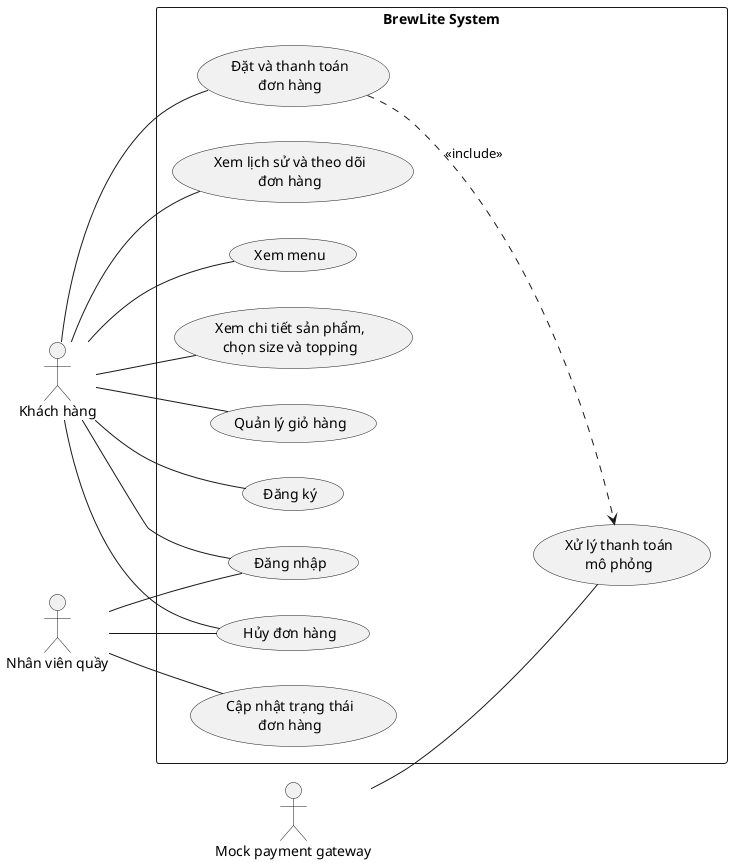

# BrewLite – Software Requirements Specification (SRS)

Tài liệu này đặc tả yêu cầu chức năng (FR), yêu cầu phi chức năng (NFR), mức ưu tiên theo MoSCoW và tiêu chí chấp nhận và sơ đồ Usecase tổng quát của hệ thống BrewLite.

## 1. Quy ước mức ưu tiên MoSCoW

- Must: Bắt buộc để đáp ứng chức năng cốt lõi.
- Should: Quan trọng, nên hoàn thành nếu nguồn lực cho phép.
- Could: Bổ sung, thực hiện khi còn thời gian.
- Won't: Không thực hiện trong phiên bản hiện tại.

## 2. Yêu cầu chức năng (Functional Requirements)

### FR-01 – Xem menu

- **Use Case:** Xem menu.
- **Mô tả:** Khách hàng xem danh sách đồ uống đang bán.
- **Ưu tiên:** Must.
- **Tiêu chí chấp nhận:**
  1. Khi tải thành công, giao diện hiển thị danh sách sản phẩm từ hệ thống.
  2. Mỗi sản phẩm hiển thị tối thiểu tên, hình ảnh và giá bán.
  3. Khi không có sản phẩm, hiển thị thông báo danh sách trống.
  4. Khi tải thất bại, hiển thị thông báo lỗi thay vì trang trống.

### FR-02 – Xem chi tiết sản phẩm, chọn size và topping

- **Use Case:** Xem chi tiết sản phẩm, chọn size và topping.
- **Mô tả:** Khách hàng xem thông tin đồ uống và lựa chọn size, topping.
- **Ưu tiên:** Must.
- **Tiêu chí chấp nhận:**
  1. Khách hàng mở được chi tiết sản phẩm đang tồn tại.
  2. Hệ thống hiển thị tên, giá và các lựa chọn size/topping khả dụng.
  3. Giá hiển thị thay đổi đúng theo size và topping đã chọn.
  4. Khi sản phẩm không tồn tại, hệ thống hiển thị thông báo phù hợp.

### FR-03 – Quản lý giỏ hàng

- **Use Case:** Quản lý giỏ hàng.
- **Mô tả:** Khách hàng thêm, sửa số lượng và xóa sản phẩm trong giỏ hàng.
- **Ưu tiên:** Must.
- **Tiêu chí chấp nhận:**
  1. Thêm được sản phẩm với size, topping và số lượng hợp lệ.
  2. Thay đổi được số lượng và xóa được sản phẩm trong giỏ.
  3. Tổng tiền được tính lại theo số lượng và các tùy chọn đã chọn.
  4. Số lượng không hợp lệ (không phải số nguyên dương) bị từ chối.
  5. Không thể đặt đơn khi giỏ hàng trống.

### FR-04 – Đăng ký tài khoản

- **Use Case:** Đăng ký.
- **Mô tả:** Khách hàng tạo tài khoản để sử dụng chức năng đặt hàng.
- **Ưu tiên:** Must.
- **Tiêu chí chấp nhận:**
  1. Dữ liệu hợp lệ được chấp nhận và tạo tài khoản thành công.
  2. Email trùng hoặc dữ liệu sai định dạng bị từ chối, kèm thông báo rõ ràng.
  3. Mật khẩu không được lưu dưới dạng văn bản thuần.

### FR-05 – Đăng nhập

- **Use Case:** Đăng nhập.
- **Mô tả:** Khách hàng và nhân viên quầy xác thực để sử dụng các chức năng phù hợp với quyền hạn.
- **Ưu tiên:** Must.
- **Tiêu chí chấp nhận:**
  1. Đăng nhập bằng thông tin hợp lệ thành công và nhận được JWT có thời hạn.
  2. Thông tin đăng nhập sai bị từ chối và hiển thị thông báo lỗi.
  3. Yêu cầu đến API được bảo vệ mà không có JWT hợp lệ bị từ chối.
  4. Hệ thống phân biệt quyền khách hàng và nhân viên khi cấp quyền truy cập.

### FR-06 – Đặt đơn hàng

- **Use Case:** Đặt và thanh toán đơn hàng.
- **Mô tả:** Khách hàng đã đăng nhập tạo đơn từ giỏ hàng hợp lệ.
- **Ưu tiên:** Must.
- **Tiêu chí chấp nhận:**
  1. Khách hàng chưa đăng nhập không thể tạo đơn.
  2. Hệ thống kiểm tra giỏ hàng, size, topping, số lượng và tình trạng còn hàng.
  3. Sản phẩm hết hàng hoặc dữ liệu không hợp lệ bị từ chối; không tạo đơn lỗi.
  4. Tổng tiền do máy chủ tính lại theo dữ liệu sản phẩm và tùy chọn.
  5. Tạo đơn thành công lưu đầy đủ chi tiết, mã đơn, tổng tiền và trạng thái ban đầu chờ thanh toán.
  6. Khi có các yêu cầu đặt hàng đồng thời, hệ thống không cho phép số lượng bán vượt quá tồn kho.

### FR-07 – Thanh toán mô phỏng

- **Use Case:** Xử lý thanh toán mô phỏng; Đặt và thanh toán đơn hàng.
- **Mô tả:** Khách hàng thanh toán đơn bằng phương thức Ví hoặc Thẻ thông qua dịch vụ mô phỏng.
- **Ưu tiên:** Must.
- **Tiêu chí chấp nhận:**
  1. Khách hàng chọn được phương thức Ví hoặc Thẻ để thanh toán đơn của mình đang chờ thanh toán.
  2. Hệ thống gửi yêu cầu đến dịch vụ thanh toán mô phỏng và nhận kết quả.
  3. Thanh toán thành công được ghi nhận và hiển thị xác nhận kèm mã đơn.
  4. Thanh toán thất bại được ghi nhận và hiển thị thông báo; khách hàng có thể thử lại khi đơn còn cho phép.
  5. Không thanh toán được đơn không tồn tại, không thuộc khách hàng hoặc đã hủy/đã thanh toán.
  6. Gửi lại cùng yêu cầu thanh toán với cùng khóa idempotency không tạo thêm giao dịch thanh toán; hệ thống trả về kết quả đã ghi nhận.
  7. Hệ thống chỉ sử dụng thanh toán mô phỏng, không thực hiện giao dịch tài chính thật.

### FR-08 – Xem lịch sử và theo dõi đơn hàng

- **Use Case:** Xem lịch sử và theo dõi đơn hàng.
- **Mô tả:** Khách hàng xem các đơn đã đặt và trạng thái hiện tại.
- **Ưu tiên:** Must.
- **Tiêu chí chấp nhận:**
  1. Khách hàng đã đăng nhập xem được danh sách đơn hàng của chính mình.
  2. Mỗi đơn hiển thị mã đơn, thời gian đặt, tổng tiền và trạng thái.
  3. Khách hàng xem được thông tin chi tiết của đơn thuộc tài khoản mình.
  4. Không thể truy cập lịch sử hoặc chi tiết đơn của khách hàng khác.
  5. Khi chưa có đơn hàng, hiển thị thông báo danh sách trống.

### FR-09 – Hủy đơn hàng

- **Use Case:** Hủy đơn hàng.
- **Mô tả:** Khách hàng hoặc nhân viên quầy hủy đơn khi trạng thái và quyền thao tác cho phép.
- **Ưu tiên:** Should.
- **Tiêu chí chấp nhận:**
  1. Khách hàng chỉ hủy được đơn của mình khi đơn chưa thanh toán thành công.
  2. Nhân viên có thể hủy đơn đã thanh toán nhưng chưa bắt đầu pha chế theo quy tắc hệ thống.
  3. Không thể hủy đơn đã hoàn thành, đã hủy hoặc đang ở trạng thái không cho phép.
  4. Hủy thành công làm trạng thái đơn chuyển thành đã hủy.
  5. Hệ thống từ chối yêu cầu hủy của người không có quyền.

### FR-10 – Cập nhật trạng thái đơn hàng

- **Use Case:** Cập nhật trạng thái đơn hàng.
- **Mô tả:** Nhân viên quầy cập nhật tiến trình xử lý đơn hàng.
- **Ưu tiên:** Should.
- **Tiêu chí chấp nhận:**
  1. Chỉ nhân viên quầy được phép cập nhật trạng thái xử lý đơn hàng.
  2. Đơn thanh toán thành công có thể chuyển lần lượt qua các trạng thái đang pha chế, sẵn sàng và hoàn thành.
  3. Trạng thái mới hợp lệ được lưu và hiển thị khi khách hàng theo dõi đơn.
  4. Chuyển trạng thái không hợp lệ bị từ chối và không làm thay đổi dữ liệu đơn hàng.

## 3. Yêu cầu phi chức năng (Non-functional Requirements)

### NFR-01 – Hiệu năng

- **Ưu tiên:** Must.
- **Tiêu chí chấp nhận:**
  1. Với dữ liệu mẫu và môi trường kiểm thử được ghi nhận, ít nhất 95% trong 100 yêu cầu lấy danh sách sản phẩm có thời gian phản hồi dưới 500 ms.
  2. Khi truy vấn thất bại, API trả về mã lỗi và thông báo phù hợp.

### NFR-02 – Bảo mật

- **Ưu tiên:** Must.
- **Tiêu chí chấp nhận:**
  1. Mật khẩu được lưu ở dạng băm, không lưu bản rõ.
  2. API yêu cầu xác thực từ chối truy cập khi thiếu hoặc sử dụng JWT không hợp lệ.
  3. Khách hàng không thể xem hoặc thao tác trên đơn hàng của tài khoản khác.
  4. API cập nhật trạng thái xử lý đơn từ chối vai trò không phải nhân viên quầy.
  5. Khóa bí mật và thông tin đăng nhập hệ thống không được đưa vào repository.

### NFR-03 – Tính khả dụng

- **Ưu tiên:** Should.
- **Tiêu chí chấp nhận:**
  1. Khi API và cơ sở dữ liệu hoạt động bình thường, endpoint kiểm tra sức khỏe hệ thống trả kết quả thành công.
  2. Khi cơ sở dữ liệu không khả dụng, endpoint kiểm tra sức khỏe phản ánh tình trạng lỗi thay vì báo hệ thống bình thường.

### NFR-04 – Khả năng triển khai

- **Ưu tiên:** Must.
- **Tiêu chí chấp nhận:**
  1. Frontend sử dụng Next.js theo hướng mobile-first/PWA, backend sử dụng NestJS và cơ sở dữ liệu PostgreSQL.
  2. Có hướng dẫn cài đặt và chạy hệ thống tại môi trường local trong `README.md`.
  3. Có tệp cấu hình môi trường mẫu không chứa thông tin bí mật thật.
  4. Có thể khởi chạy frontend, backend và PostgreSQL bằng Docker Compose.

## 4. Sơ đồ Use Case tổng quát

